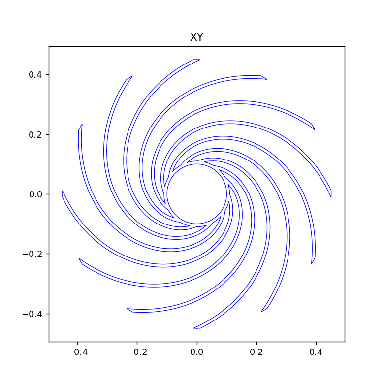
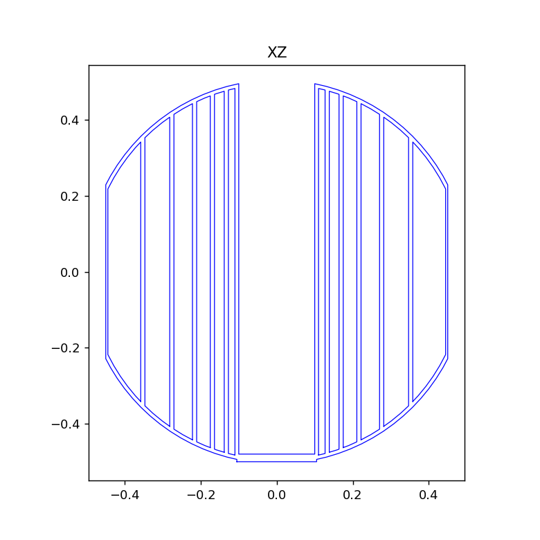
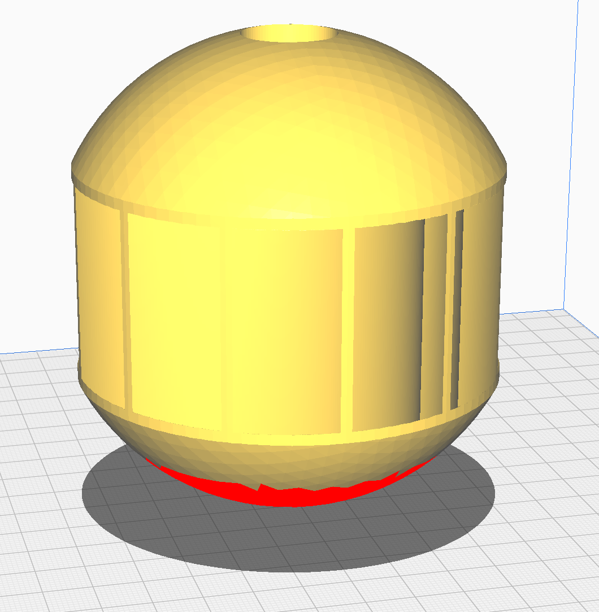
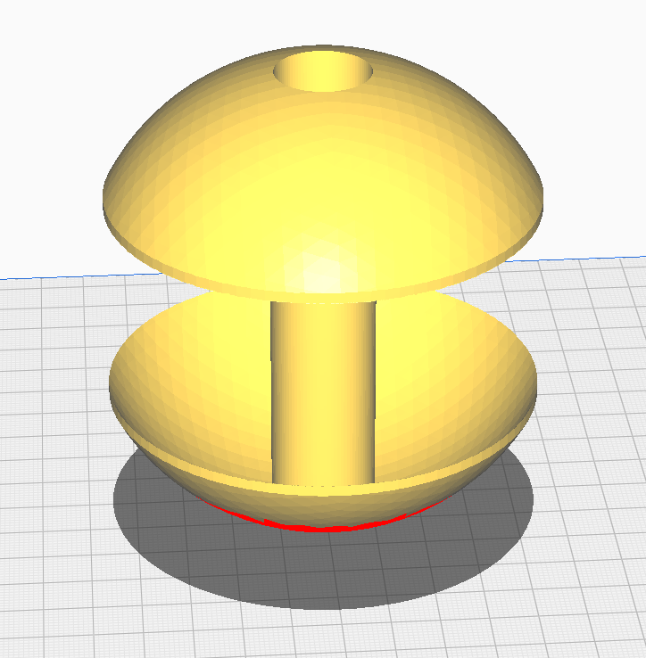

```bash
python3 make_shell.py && python3 make_shell.py --control
{
  "name": "shell",
  "control": false,
  "watertight": true,
  "winding_consistent": true,
  "volume_m3": 0.0988580421992607,
  "bodies": 1,
  "faces": 36008,
  "bounds": [
    [
      -0.44999998807907104,
      -0.44999998807907104,
      -0.49989795684814453
    ],
    [
      0.44999998807907104,
      0.44999998807907104,
      0.49495163559913635
    ]
  ],
  "symmetry_overlap": 0.9973823937734012
}
ПРОВЕРКА: OK
{
  "name": "control",
  "control": true,
  "watertight": true,
  "winding_consistent": true,
  "volume_m3": 0.023885235709707353,
  "bodies": 1,
  "faces": 9748,
  "bounds": [
    [
      -0.44999998807907104,
      -0.44999998807907104,
      -0.49989795684814453
    ],
    [
      0.44999998807907104,
      0.44999998807907104,
      0.49495163559913635
    ]
  ]
}
ПРОВЕРКА: OK
```

## Этап A закрыт

Теперь обе модели (полная и контрольная) замкнуты, состоят из одного куска и проходят проверку. Причиной сбоя в контроле была склейка вершин, и отключение `process=True` её устранило. Картинки сечений должны были построиться, потому что ошибка про `matplotlib` в этот раз не появилась. 










В сечении XY видны 12 спиральных рёбер и круглое отверстие, в XZ — полая труба с плитой внизу.